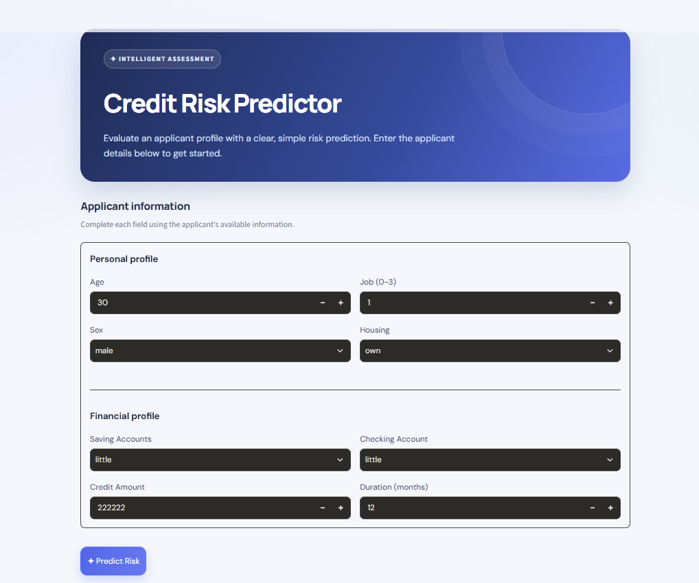

# Credit Risk Predictor

A Streamlit app that predicts whether a loan applicant is a good or bad credit risk. The model is an Extra Trees classifier trained on the German Credit dataset.



You enter eight details about an applicant (age, sex, job level, housing, saving and checking account status, credit amount, loan duration), click **Predict Risk**, and the app returns GOOD or BAD.

## Results

The deployed model gets **64.8% accuracy** on a held-out test set of 105 applicants. Always predicting "good" would get 55.7% on the same data, so the model is better than the baseline, but not by a lot.

I tuned four models with 5-fold grid search and compared them on the same split:

| Model | Test accuracy |
|---|---|
| Decision Tree | 58.1% |
| Extra Trees (used in the app) | 64.8% |
| Random Forest | 66.7% |
| XGBoost | 66.7% |

With only 105 test rows, a gap of one or two predictions moves accuracy by about 1-2 points, so the three ensemble models are close to indistinguishable here.

**What mattered most.** Loan duration is the strongest feature by a wide margin (about 30% of feature importance), followed by credit amount (13.5%) and checking account status (12.4%).

**What the data shows.**
- Bad-risk loans are larger and longer: an average of 3,881 vs 2,801 in credit amount, and 25 vs 18 months in duration.
- Age is nearly the same across both groups (34.1 vs 35.5 years).
- All seven loans of 60+ months in the cleaned data are labelled bad.

## Data

German Credit dataset: 1,000 applicants, 700 good and 300 bad. `Saving accounts` is missing for 183 rows and `Checking account` for 394. I dropped every row with a missing value, which left **522 rows** (291 good, 231 bad). That is a big loss of data and the main weakness of this project.

Features used: Age, Sex, Job (0-3), Housing, Saving accounts, Checking account, Credit amount, Duration. `Purpose` is explored in the notebook but not used in the model.

## How it works

1. Clean the data and explore it (`analysis_model.ipynb`)
2. Label-encode the categorical columns and save each encoder with joblib
3. Split 80/20 (stratified), tune and compare the four models
4. Save the Extra Trees model
5. `app.py` loads the model and encoders and encodes the form inputs the same way as in training

## Files

```
app.py                         Streamlit app
analysis_model.ipynb           EDA, preprocessing, model training and comparison
german_credit_data.csv         dataset
extra_trees_credit_model.pkl   trained model
*_encoder.pkl                  label encoders (Sex, Housing, Saving accounts, Checking account, target)
requirements.txt
```

## Run it locally

```bash
git clone https://github.com/ahmedjoy1922-lang/credit-risk-predictor.git
cd credit-risk-predictor
pip install -r requirements.txt
streamlit run app.py
```

The app runs at http://localhost:8501.

## Limitations

- 65% accuracy on a small dataset is fine for a learning project and not good enough for real lending decisions.
- Only accuracy was evaluated. Precision, recall and F1 for the bad class would say more about how the model errs.
- The dataset includes sex and age, which are restricted or sensitive in real credit scoring.
- The app shows a label only, with no probability and no explanation.

## Next steps

- Impute the missing account values instead of dropping rows
- Report precision, recall and F1
- Show the predicted probability in the app
- Wrap the encoders and model in a single scikit-learn `Pipeline`

## Tech

Python, pandas, scikit-learn, XGBoost, Matplotlib, Seaborn, Streamlit, joblib.

Built by [Asif Ahmed Joy](https://github.com/ahmedjoy1922-lang).
